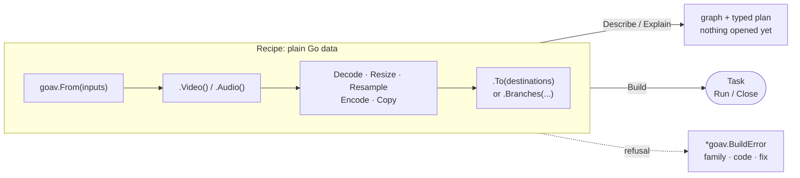

<div align="center">

# goav

**Media pipelines in pure Go.** Decode, transform, encode, and mux inside your service:<br>no cgo, no FFmpeg, no system libraries.

[](https://github.com/thesyncim/goav/actions/workflows/ci.yml) [](https://pkg.go.dev/github.com/thesyncim/goav) [](go.mod) [](LICENSE) [](docs/V1_SCOPE.md)

</div>

goav is a small, composable grammar for media work in Go: select streams, chain operations,
fan out, and route to destinations. Codecs and containers are pure Go, so VP8, VP9, AV1,
Opus, AAC, and WebM/Matroska/MP4 support builds into one static binary with `CGO_ENABLED=0`.
A recipe is plain data until it runs: print its exact graph first, and get every mistake
back as a typed error that names the fix.

## Quick start

```sh
go get github.com/thesyncim/goav@latest   # Go 1.27+

# No WebM handy? The goav CLI writes a 2-second 1080p VP9 test clip:
go run github.com/thesyncim/goav/cmd/goav@latest run 'testsrc video width=1920 height=1080 fps=30 frames=60 realtime=false ! encode codec=vp9 media=video ! filesink location=in.webm'
```

```go
// Decode a WebM, scale it to 720p, re-encode it as VP9, and mux a new WebM.
// in is any io.Reader (an *os.File works); out is any io.Writer.
err := bundle.Run(ctx, goav.From(goav.FileInput("in.webm", in)).
    Video().
    Decode().
    Resize(1280, 720).
    Encode(codec.VP9(codec.Bitrate(2_000_000))).
    To(goav.Write("out.webm", out)))
```

`bundle.Run` plans, builds, and runs the recipe with the bundled adapters, and closes `out` if it
is an `io.Closer`. The [CLI reference](docs/CLI.md) covers the test-source syntax.

## Plan first, with errors that name the fix



`bundle.Describe(ctx, job)` returns the exact graph `Build` would create and `job.Explain(ctx)` a
typed, JSON-stable [`plan.Report`](plan), before anything opens. [`graphrender`](graphrender)
prints the graph as text, DOT, or Mermaid; `graphrender.RenderURI(spec, "goav:graph")` lists the
quick-start recipe's nodes:

```text
pipeline goav
  source in.webm [demux, protocol=file]
  stage select-video [select, type=video]
  stage decode-video [packets -> frames, type=video]
  stage resize-video [resize, 1280x720, exact]
  stage encode-video [frames -> packets, codec=vp9]
  stage out.webm [mux, protocol=file]
```

Every build refusal is a `*goav.BuildError` with a stable `Family` and `Code`, the failing node,
typed details, and fixes spelled as real calls, returned before any resource opens. Leave out
the encoder (`goav.From(input).Video().Decode().To(goav.Write("out.webm", out))`) and `Run` returns:

```text
goav: cannot build job for video: decoded frames cannot be written to a muxed output without an encoder
Details:
  - expected_shape=domain=packet media=video
  - actual_shape=domain=frame media=video
Suggestions:
  - call .Encode(codec.VP8(...)), .Encode(codec.VP9(...)), or .Encode(codec.AV1(...)) before .To(goav.Write(...))
  - send decoded frames to goav.Sink(...)
  - use .Copy().To(output) if you want to copy packets without decoding
```

Match with `errors.As` and switch on `Family` (`encode`), then `Code` (`encode_missing`). The
[error catalog](docs/ERROR_CATALOG.md) lists every code; `TestErrorAcceptanceFramesIntoContainerWithoutEncode` pins this one.

## What's in the box

| | Decode / demux | Encode / mux |
| --- | --- | --- |
| Video | VP8, VP9, AV1, H.264 (`goav_goh264` build tag) | VP8, VP9, AV1 |
| Audio | Opus, AAC-LC | Opus |
| Containers | Matroska, WebM, IVF, MP4 | Matroska, WebM, IVF, Annex B (H.264) |

Filters: `Resize` (I420, nearest-neighbor today) and `Resample` (S16 PCM). Backends are separate
pure-Go modules (`govpx`, `goav1`, `gopus`, `goaac`, `goh264`). `goav.New(...)` builds a
per-service runtime with exactly the adapters you register (`bundle.New(...)` starts from this
set); there is no global registry. Full matrix: [Adapters](docs/ADAPTERS.md).

## Recipes

| Need | Shape |
| --- | --- |
| Remux without decoding (H.264 too, in any build) | `goav.From(input).Copy().To(goav.Write("out.mkv", w))` |
| Audio and video into one file | `out := goav.Write("out.webm", w)`, then `.Video()…To(out).Audio()…To(out)`: one handle, one mux |
| Decoded frames into your code | `.Video().Decode().To(goav.Sink(component.SinkFunc("frames", fn)))` |
| Normalize audio | `.Audio().Decode().Resample(48000, 2).Encode(codec.Opus())` |
| One decode, many renditions | `.Decode().Branches(goav.Branch("720p").Resize(1280, 720).Encode(...).To(...), ...)` |
| Ingest RTP or WebRTC | `goav.Input(rtpav.Receive(r, rtpav.WithCodec(codec.Opus())))`, `goav.Input(webrtcav.Track(t))` |
| Your own source, sink, or codec | `goav.Source(...)`, `goav.Input(provider)`, `goav.Custom(...)`, `runconfig.WithEncoder(...)` |
| Test a pipeline | [`goavtest`](goavtest): deterministic sources, a recording sink, a fake clock |

More in [Operations](docs/OPERATIONS.md), [Use cases](docs/USE_CASES.md), the
[extension cookbook](docs/EXTENSION_COOKBOOK.md), and [`examples/`](examples), including a browser
[WebRTC ladder](examples/webrtc-runtime-ladder) and a native [Gio control room](examples/gio-webrtc-showcase).

## Built for live services

- **One clock per task.** Paced sources, sink playout (`flow.Playout`), `Pause`/`Resume`, seek,
  rate, and QoS lateness reports share one timeline; branch buffers (`flow.Blocking`,
  `flow.DropOldest`, ...) backpressure or shed per branch and count every drop. [Flow control](docs/FLOW_CONTROL.md)
- **Pinned allocations.** `testing.AllocsPerRun` guards hold graph, codec, format, and filter stages
  at zero allocations per message, `source.Push` at most one (`TestSourcePushDeliveryAllocs`).
- **SIMD without assembly.** Go 1.27's `GOEXPERIMENT=simd` (the CI and release default) moves the
  codec backends onto portable Go `simd` paths; without it you get scalar paths, and the repo has no
  assembly (`TestNoRepositoryAssembly`). Local, Apple M4 Max, benchstat n=5: real-codec time fell 45%
  geomean (VP8 decode 59.5→16.5 µs/op, VP9 encode 220→114), allocs unchanged. See [Performance](docs/PERFORMANCE.md).

## Modules

| Module | Adds |
| --- | --- |
| `github.com/thesyncim/goav` | grammar, planner, runtime; bundled adapters in [`bundle`](bundle) |
| [`github.com/thesyncim/goav/rtpav`](rtpav) | RTP ingest: jitter buffer, Opus/VP8/VP9/H.264/AV1 depacketizers, RTCP feedback (Pion) |
| [`github.com/thesyncim/goav/webrtcav`](webrtcav) | WebRTC remote tracks as goav inputs (Pion) |
| [`github.com/thesyncim/goav/playoutav`](playoutav) | scheduled packet, frame, and event playout source |

The root module requires only `thesyncim/*` modules plus the pure-Go AAC runtime, pinned by
`TestRootModuleDependencyPurity`, so importing goav never pulls in Pion.

## Status

**Pre-v1:** breaking changes can land until the first tag. The recipes above are the v1 front door.
Live mutation (`LiveTask.Attach`/`Detach`), socket control ([`ctlserver`](ctlserver), `goav ctl`),
joins (`goav.Mix`/`Composite`/`Select`), and the `expert` graph are implemented and tested but stay
governed pre-v1. See [V1 scope](docs/V1_SCOPE.md) and the [roadmap](docs/ROADMAP.md).

---

[All docs](docs/README.md) · [Architecture](docs/ARCHITECTURE.md) · [Errors](docs/ERRORS.md) · [Adapter authoring](docs/ADAPTER_AUTHORING.md) ·
[RTP & WebRTC](docs/RTP_WEBRTC.md) · [Control plane](docs/CONTROL_PLANE.md) · [vs GStreamer](docs/GSTREAMER_ALTERNATIVE.md) ·
[Changelog](CHANGELOG.md) · [Contributing](CONTRIBUTING.md) · [Security](SECURITY.md)
