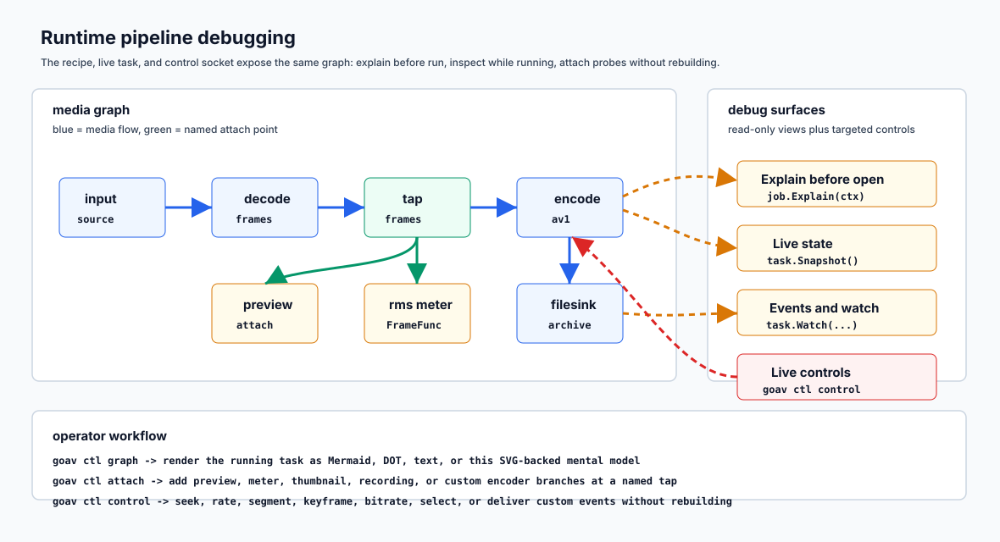

# Use Cases

This is the cookbook layer. It shows the shapes you are likely to copy first,
then points to the deeper reference docs when you need the edge cases.

The examples are intentionally ordinary: they use the same `input stream ->
operations -> .To(destinations) -> rt.Run` grammar whether the media comes from
a file, RTP, WebRTC, or your own application. `rt` is a runtime from
`bundle.New()`; `bundle.Run(ctx, outputs...)` runs on the default bundle.

## WebRTC Receive

When a Pion `TrackRemote` enters your app, goav treats it as another input.
You can preserve packets for recording, decode for preview, or attach analysis
later without rebuilding the receive path.

Packet-preserving recording:

```go
in := goav.Input(webrtcav.Track(track))
err := rt.Run(ctx, in.To(goav.Write("recording.ivf", file)))
```

Pass the same destination value to every Output that should feed one mux or
sink. Separately constructed destinations with the same name are rejected, so
sharing is always explicit.

Decoded preview:

```go
err := rt.Run(ctx, in.Video().Decode().To(goav.Sink(preview)))
```

Several realtime inputs compose in one run: each Output's stream starts from
its own input value (`mic.Audio()`, `cam.Video()`).

## RTP Receive

Raw RTP uses Pion RTP packet types through `rtpav.PacketReader`. Give RTP
inputs codec intent so the runtime can choose the depacketizer before packets
arrive.

```go
cam := goav.Input(rtpav.Receive(video, rtpav.WithName("video"), rtpav.WithCodec(codec.VP8())))
err := rt.Run(ctx, cam.To(
    goav.Write("recording.ivf", file),
    goav.Write("preview.ivf", preview),
))
```

Decode and transform one selected stream:

```go
mic := goav.Input(rtpav.Receive(audio, rtpav.WithName("audio"), rtpav.WithCodec(codec.Opus())))
err := rt.Run(ctx, mic.Audio().
    Decode().
    Resample(16_000, codec.Mono).
    Encode(codec.Opus(codec.Bitrate(48_000))).
    To(goav.Write("preview.ogg", preview)))
```

When a media type matches several streams, the build error lists candidates and
suggests the narrow selector to add: `StreamID` or `StreamIndex(0)`.

## Live Audio Rooms

Rooms are where the runtime model pays off. Participants join, leave, and
reconnect while you still need per-track work for levels, moderation,
transcription, recording, and maybe one mixed output for playback or archive.

Use `goav.Mix(streams...)` when the streams are known when the recipe is built.
When membership changes at runtime, keep each participant as an
application-owned stream. The application owns the registry, attaches ordinary
Outputs from `task.Track(input, participantStream)` before accepting media, emits
`EventStreamAdded` / `EventStreamRemoved`, and feeds any mixed output after the
per-track routes exist.

```go
room := NewRoom("room", 48_000, 1)
input := room.Input()
tracks := NewTrackRecorder()
mix := NewOutputMixer()
meter := NewTrackMeter()
trackMeter := component.FrameFunc("track-meter", func(_ context.Context, frame *av.Frame, emit component.Emit) error {
    meter.Observe(frame)
    return emit.Frame(frame)
})
anchor := goav.Sink(component.SinkFunc("room-anchor", func(context.Context, component.Message) error {
    return nil
}))

task, err := rt.Build(ctx, input.Audio().To(anchor))
if err != nil {
    return err
}
go func() { _ = task.Run(ctx) }()

attachments := map[string]goav.Attachment{}
join := func(name string) error {
    track := task.Track(input, room.ParticipantStream(name))
    attachment, err := task.Attach(ctx,
        track.Do(trackMeter).As("track-"+name).To(tracks.Sink()),
        track.As("mix-"+name).To(mix.Sink()),
    )
    if err != nil {
        return err
    }
    if err := room.Join(ctx, name); err != nil {
        _ = task.Detach(ctx, attachment, lifecycle.AbortBranch())
        return err
    }
    attachments[name] = attachment
    return nil
}

leave := func(name string) error {
    attachment, ok := attachments[name]
    if !ok {
        return fmt.Errorf("%s is not active", name)
    }
    if err := room.Leave(ctx, name); err != nil {
        return err
    }
    if err := task.Detach(ctx, attachment, lifecycle.DrainBranch()); err != nil {
        return err
    }
    delete(attachments, name)
    return nil
}

_ = join("host")
_ = join("music")
_ = room.Push(ctx, map[string][]int16{
    "host":  []int16{100, 100},
    "music": []int16{25, -50},
})
_ = leave("music")
```

`input.OnStream(match)` is still useful when a source discovers tracks itself
and automatic attachments are enough. For app-owned room membership, explicit
`task.Track(input, track)` anchors make the first-frame boundary deterministic.

The runnable module `examples/dynamic-audio-room` validates this pattern with
`goavtest/expect`: it proves runtime participant add/remove events, S16
summing and clamping in the output mixer, per-track processing, and
inactive-track rejection. It deliberately does not add a root `Room` API:
rooms are an application pattern built from normal streams, attachments,
destinations, snapshots, and detach semantics.

## Fanout

`Tap(name)` names a stable point; whether it carries frames or packets follows
its position. Reusing a Stream value forks it, and each fork is ordered
operations: custom stages, transforms, taps, optional encode, then
destinations. Mux destinations require encoded packets; sink destinations
receive decoded frames before encode, or packets after encode or copy (a stream
routed without `.Decode()` copies).

```go
main := goav.Write("main.webm", out)

err := rt.Run(ctx,
    input.Video().Decode().
        Resize(1280, 720).
        Do(frameMeter).
        Tap("video.720p.frames").
        Encode(codec.VP9(codec.Bitrate(2_000_000))).
        As("720p").
        To(main),
    input.Audio().Decode().
        Resample(48_000, codec.Stereo).
        Encode(codec.Opus(codec.Bitrate(96_000))).
        As("a96").
        To(main),
)
```

One destination can be shared: several encoded Outputs feed one mux when they
are given the same destination value. A destination can also be a sink after
any operation (no encode needed for frame-domain ends).

A fork starts wherever a Stream value is reused, so an earlier operation
boundary is an earlier variable; the work before the fork runs once:

```go
decoded := input.Video().Decode().Tap("video.decoded")
thumbs := goav.Sink(component.SinkFunc("thumbs", collectThumbnail))
web := goav.Write("web.ivf", webFile)

err := rt.Run(ctx,
    decoded.Resize(320, 180).As("thumb").To(thumbs),
    decoded.Resize(1280, 720).
        Tap("video.720p.frames").
        Encode(codec.VP9(codec.Bitrate(2_000_000))).
        As("web").
        To(web),
)
```

## Custom Components

A stage can live inside a normal stream recipe, a sink can receive frames
before encode or packets after copy/encode, and a running task can attach a
sink from a declared tap. A packet stream, copied or encoded, can fan out to
both mux destinations and packet sinks; reusing an undecoded Stream splits it
without a decoder, and a fork can call `.Decode()` first when it needs raw
frames.

```go
meter := component.FrameFunc("meter", func(ctx context.Context, frame *av.Frame, emit component.Emit) error {
    observe(frame)
    return emit.Frame(frame)
})

err := rt.Run(ctx, input.Audio().
    Decode().
    Do(meter).
    To(goav.Sink(component.SinkFunc("levels", collectLevel))))
```

Custom sources are the input-side equivalent for applications that already own
media production. Packet sources use `shape.Packet`, frame sources use
`shape.Frame` and skip decode, event-only sources use `shape.Event` and route
straight to sinks. Each push returns a `source.Result` reporting `Accepted` and
`Dropped`, so realtime shedding is visible without being an error.

```go
input := goav.Source("generated",
    shape.Packet(av.MediaAudio, av.CodecOpus,
        shape.Audio(48_000, codec.Stereo, av.SampleFormatS16),
    ),
    func(ctx context.Context, push source.Push) error {
        for packet := range packets {
            if _, err := push.Packet(&packet); err != nil {
                return err
            }
        }
        return push.EOS()
    },
)

err := rt.Run(ctx, input.Audio().To(goav.Sink(packetSink)))
```

Custom sources participate in the same stream, fanout, destination, explain,
and runtime graph path as built-in inputs.

## Reuse

When operations repeat, write a function. A Stream is a value, so a reusable
operation sequence is a plain Go function of one; each Output keeps its own
destinations, so reusable and ad hoc forks use the same API.

```go
voice := func(s goav.Stream) goav.Stream {
    return s.Resample(16_000, codec.Mono).
        Encode(codec.Opus(codec.Bitrate(32_000), codec.Channels(codec.Mono)))
}
archive := func(s goav.Stream) goav.Stream {
    return s.Resample(48_000, codec.Stereo).
        Encode(codec.Opus(codec.Bitrate(128_000), codec.Channels(codec.Stereo)))
}
in := goav.Input(rtpav.Receive(audio, rtpav.WithName("audio"), rtpav.WithCodec(codec.Opus())))
decoded := in.Audio().Decode()

err := rt.Run(ctx,
    voice(decoded).As("voice").To(goav.Write("voice.ogg", voiceFile)),
    archive(decoded).As("archive").To(goav.Write("archive.ogg", archiveFile)),
)
```

The same function applies to a stream attached later from `task.Tap(name)`.
Reuse the decoded value when one media point needs several downstream
operation sequences; it decodes once.

## Runtime Branches

Runtime branches are late control-plane work: analysis, meters, screenshot
collectors, recordings, or temporary sinks that attach to future messages
without rebuilding upstream.

A buffer is local to its fork: `.Buffer(...)` runs the rest of the fork behind
its own queue, so one slow consumer backpressures or sheds alone:

```go
archiveOut := audio.Buffer(flow.Blocking(128)).To(archive)
previewOut := audio.Buffer(flow.DropOldest(3)).To(preview)
latestOut := audio.Buffer(flow.Latest()).
    To(goav.Sink(component.SinkFunc("latest", inspect)))
```

Attach a late Output from a tap; encode from frame taps, copy (no `.Decode()`)
or decode from packet taps:

```go
recording := goav.Write("recording.ogg", file)

recordingHandle, err := task.Attach(ctx,
    task.Tap("audio.decoded").
        Encode(codec.Opus(codec.Bitrate(96_000))).
        As("record-audio").
        To(recording),
)
if err != nil {
    return err
}
defer recordingHandle.Close(ctx)
```

Attach several late Outputs in one call when they should appear or disappear
together. A later Output in the same call can read a tap an earlier one
declares, and one destination value can receive several sink or mux Outputs:

```go
recording := goav.Write("recording.webm", file)

group, err := task.Attach(ctx,
    task.Tap("audio.encoded").As("audio").To(recording),
    task.Tap("video.encoded").As("video").To(recording),
)
if err != nil {
    return err
}
defer group.Close(ctx)
```

Use `task.Taps()` to discover stable outlets and `task.Detach(ctx, h)` for a
plain removal, `lifecycle.DrainBranch()` when the branch output should commit, or
`lifecycle.AbortBranch()` when it should be abandoned. Taps declared after encode, or
on a stream that never decodes, are packet taps. Observer Outputs can end in a sink while
publishing a nested tap with `.Do(component.FrameFunc(...)).Tap(name).To(goav.Sink(...))`.
Detaching a parent removes dependent late branches anchored from its taps. H264
recipe encoding remains work in progress.

## Debug And Diagnostics

Debugging uses the same composition grammar. Explain the plan before opening the
graph, watch task events while it runs, then attach temporary Outputs from
taps. `Attachment.Snapshot()` reports the attached branch, and
`task.Snapshot()` reports the whole graph plus active branches with typed
lifecycle states.



```go
out := goav.Input(webrtcav.Track(track)).Audio().
    Decode().
    Tap("audio.decoded").
    To(goav.Sink(playback))

report, err := rt.Explain(ctx, out)
if err != nil {
    return err
}
for _, warning := range report.Warnings {
    log.Printf("plan warning code=%s node=%s msg=%s",
        warning.Code, warning.Node, warning.Message)
}

task, err := rt.Build(ctx, out)
if err != nil {
    return err
}
go func() {
    for event := range task.Watch().Events() {
        log.Printf("media event type=%s stream=%s", event.Type, event.StreamID)
    }
}()
go func() { _ = task.Run(ctx) }()

levels, err := task.Attach(ctx,
    task.Tap("audio.decoded").
        Do(component.FrameFunc("rms", func(_ context.Context, frame *av.Frame, emit component.Emit) error {
            observeRMS(frame)
            return emit.Frame(frame)
        })).
        As("levels").
        To(goav.Sink(component.SinkFunc("levels", func(context.Context, component.Message) error {
            return nil
        }))),
)
if err != nil {
    return err
}
defer levels.Close(ctx)

state := task.Snapshot()
levelFrames := uint64(0)
for _, branch := range state.Branches {
    if branch.Name == "levels" {
        levelFrames = branch.Stats.Frames
    }
}
log.Printf("packets=%d frames=%d dropped=%d branches=%d level_frames=%d",
    state.Stats.Packets,
    state.Stats.Frames,
    state.Stats.Dropped,
    len(state.Branches),
    levelFrames)
```

## Generic File Or Protocol Ingest

Packet-preserving file fanout:

```go
err := rt.Run(ctx, goav.FileInput("input.ivf", in).To(
    goav.Write("recording.ivf", recording),
    goav.Write("preview.ivf", preview),
))
```

When packet formats already match, recording stays packet-preserving. IVF
covers VP8/VP9/AV1 packet recording; Annex B covers packet-preserving H264
recording after RTP depacketization.

## Resample And Resize

Audio filters express sample rate, channel count/layout, and sample format; the
first concrete adapter covers interleaved `s16` PCM with linear conversion.
Video filters express exact, fit, fill, and passthrough modes; the first
concrete adapter covers planar 8-bit 4:2:0 frames with area-averaged
downscaling, linear upscaling, and caller-owned output planes.
